# Quilimon

**Et legendarisk kortspill av Jakob Vege — nå digitalt.**

Quilimon ble tegnet og funnet opp for hånd av Jakob da han var barn: sju monstre, tusj
og fargeblyant, terninger og angrep. Dette prosjektet gjør kortene om til et spill du kan
spille i nettleseren, laget som bursdagsgave til Jakob. De originale tegningene er skannet
inn og brukt som kortgrafikk.

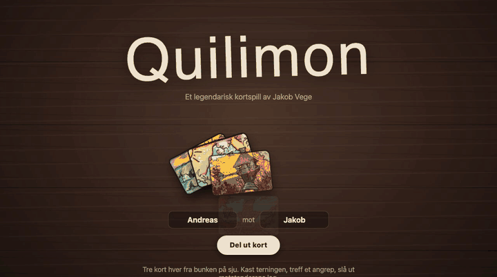

## Slik spiller du

To spillere deler samme skjerm (hot seat). Bunken har sju kort, og hver spiller får tre
tilfeldige — det sjuende blir liggende igjen.

1. **Kast terningen.** Hvert angrep har et terningkrav, for eksempel `⚃–⚅`. Treffer kastet,
   lyser angrepet opp og kan brukes.
2. **Velg et angrep.** Skaden trekkes fra motstanderens aktive monster.
3. **Bytt fritt.** Du kan sette inn et annet monster fra laget når som helst. Et monster som
   byttes ut beholder skaden sin.
4. **Slå ut hele laget.** Et monster på 0 HP er beseiret. Den som først mister alle tre, taper.

Treffer ikke kastet noe, står du over og turen går videre.

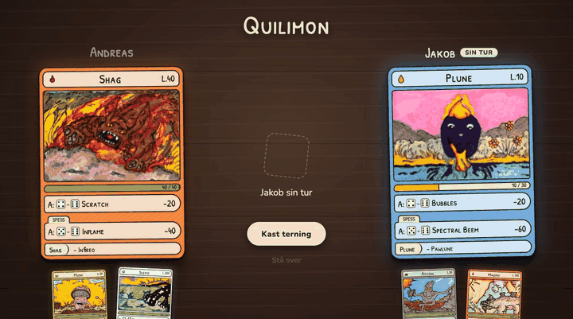

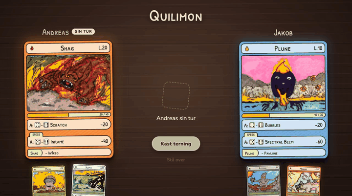

## Monstrene

| | | | |
|:-:|:-:|:-:|:-:|
| 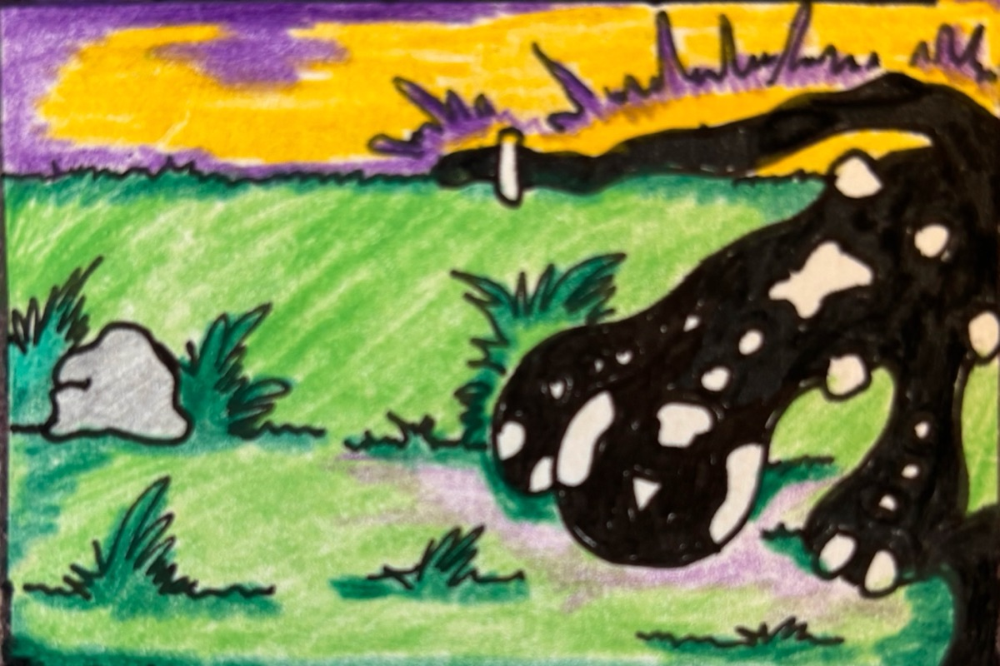<br>**Slepio** · 200 HP | 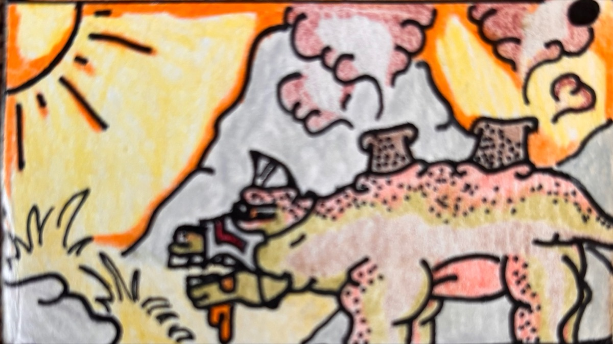<br>**Magmo** · 100 HP | 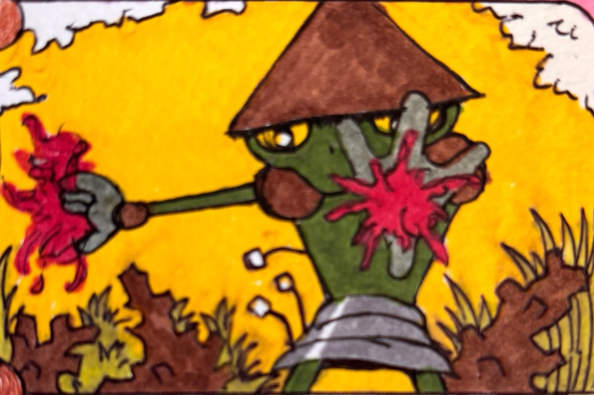<br>**Magecko** · 60 HP | 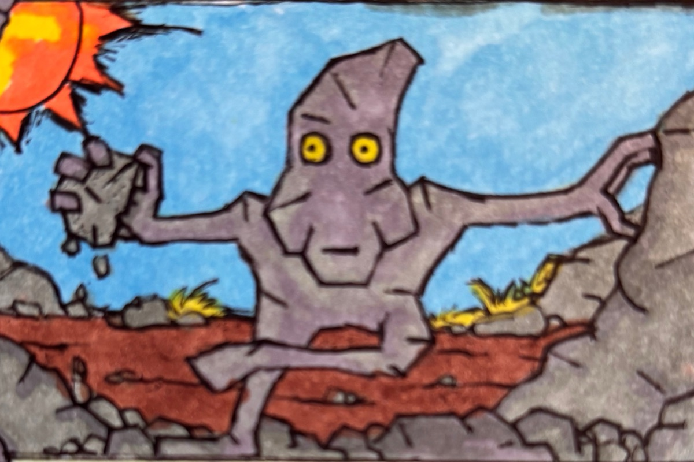<br>**Atcool** · 50 HP |
| 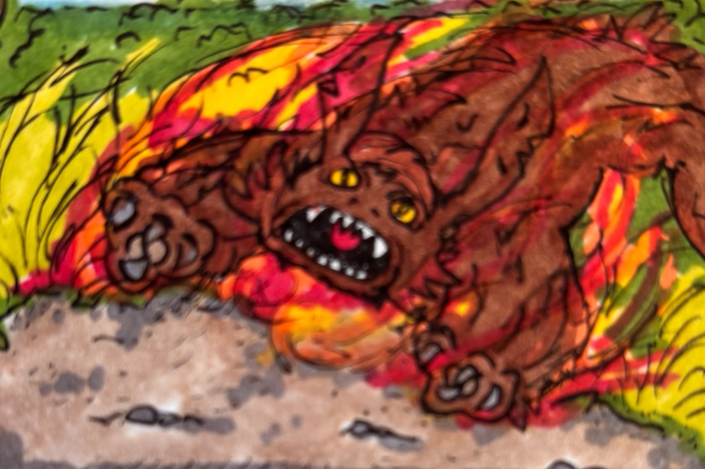<br>**Shag** · 40 HP | 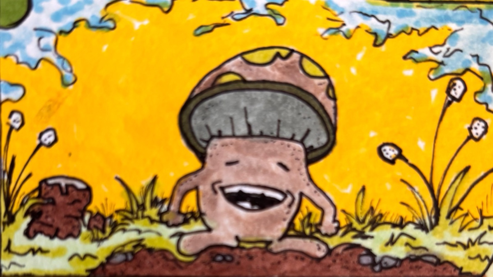<br>**Mush** · 30 HP | 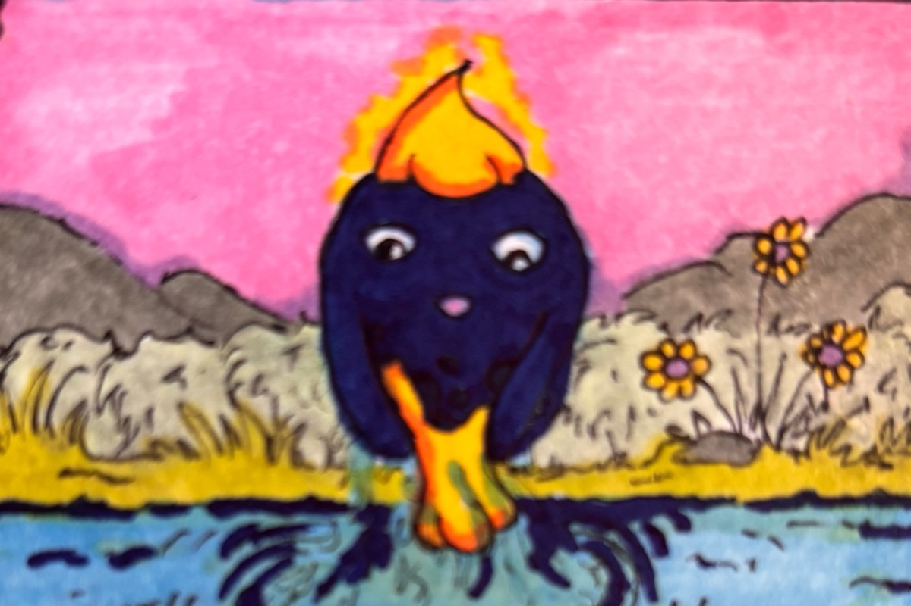<br>**Plune** · 30 HP | |

Hvert kort har to handlinger. De fleste gjør skade, men noen har effekter:

- **Mind Infuse** (Slepio) — gjør skade og lar deg angripe en gang til
- **Magma Smoke** (Magmo) — blender motstanderen, som ikke kan angripe neste runde
- **Pollen** (Mush) — motstanderen må slå en sekser for å angripe neste runde
- **Rock Throw** (Atcool) — skaden er 10 × terningverdien

Grip, Reflekt og Mageckos forsvarsangrep er merket med \* på kortene — de virker ikke ennå.

## Skjermbilder

<p align="center">
  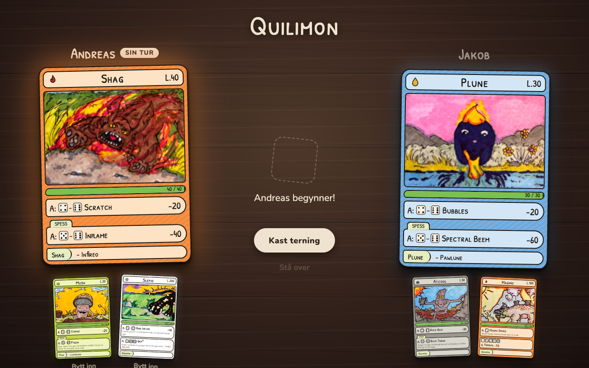
  &nbsp;
  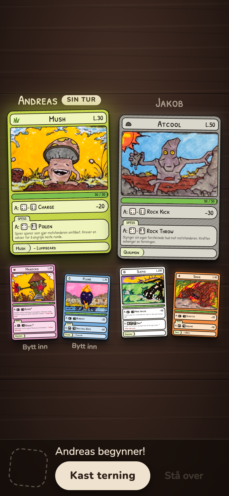
</p>

Spillet fungerer på PC, nettbrett og mobil. Kortene er bygget opp etter Jakobs originaler:
typeikon, navn og HP øverst, tegningen, en HP-stripe og angrepene som fargede bånd.

<p align="center">
  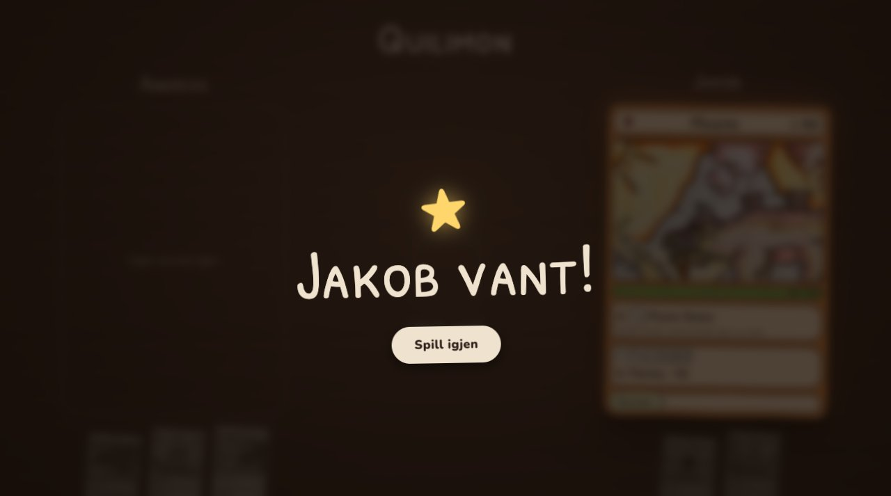
</p>

## Kom i gang

Du trenger [Node.js](https://nodejs.org/) (versjon 20 eller nyere).

```bash
npm install
npm run dev
```

Åpne adressen Vite skriver ut (vanligvis http://localhost:5173).

Andre kommandoer:

| Kommando | Hva den gjør |
|---|---|
| `npm run build` | Typesjekker og bygger en ferdig versjon til `dist/` |
| `npm run preview` | Viser den bygde versjonen lokalt |
| `npm run lint` | Kjører ESLint |
| `npx tsx scripts/play.ts` | Spiller i terminalen, uten grafikk |

## Slik er det bygget

Vite + React + TypeScript. Det viktigste prinsippet er at **spillreglene og grafikken er helt
adskilt**, slik at utseendet kan tegnes om uten å røre reglene.

```
src/
├── game/          Spillmotoren — rene regler, ingen React
│   ├── cards.ts       De sju kortene som ren data
│   ├── attacks.ts     De 14 handlingene (skade, terningkrav, effekt)
│   ├── gamestate.ts   Typene som beskriver et spill
│   ├── events.ts      Hendelsene en handling sender ut
│   └── actions.ts     createGame, rollDice, attack, switchMonster, endTurn
├── ui/            Det grafiske skallet (React)
├── assets/        Original/ = fotoene, Cropped/ = skannet og beskåret, Web/ = nedskalert
└── App.tsx        Startskjerm og utdeling
scripts/play.ts    Tekstversjonen i terminalen
```

- **Immutabel tilstand.** Hele spillet er ett `GameState`-objekt. Hver handling tar inn en
  tilstand og returnerer en ny — den gamle endres aldri.
- **Hendelseslogg.** Hver handling returnerer også en liste hendelser (`damageDealt`,
  `cardDefeated`, `gameEnded` …). UI-et spiller av animasjonene i den rekkefølgen.
- **Datadrevne kort.** Et nytt kort er en ny oppføring i `cards.ts` og `attacks.ts`, ikke
  ny motorkode.
- **Samme motor, to skall.** Både nettleserspillet og terminalspillet kaller de samme
  funksjonene i `actions.ts`.

## Veien videre

- Effektene som mangler: Grip, Reflekt og Mageckos forsvar
- Balansering — Fireball og Mind Infuse er mistenkt for å være for sterke
- Evolusjon (Mush → Lumpbeard, Shag → Infireo, Plune → Pawlune står allerede på kortene)
- Kanskje en egen versjon i en spillmotor, med Jakob på det visuelle

---

*Alle monstre, navn og tegninger er laget av Jakob Vege.*
